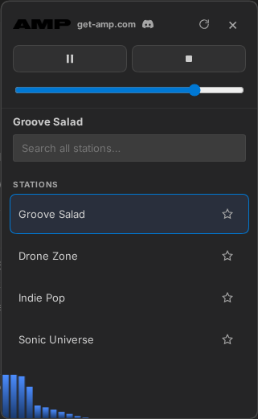

# DSH-AMP-Radio

**AMP radio player** for DeepSeek Harness.

A clean internet-radio player that lives in your DeepSeek Harness composer dock. Pick a station, press play, and enjoy.

**Official website:** [get-amp.com](https://get-amp.com)

<a href="https://discord.gg/hr3zfQmyVQ"><svg viewBox="0 0 127.14 96" width="22" height="17" aria-hidden="true"><path fill="#5865F2" d="M107.7 8.07a105 105 0 0 0-32.45-10l-2.33 4.73a98 98 0 0 0-31.08 0l-2.33-4.73a105 105 0 0 0-32.45 10C1.25 38.41-3.15 68.4 1.7 97.9a105.7 105.7 0 0 0 32.45 10l2.33-4.73a98 98 0 0 0-16.06-7.6l.42-.32a80 80 0 0 0 23.2 7.18l1.77-4.5a85 85 0 0 0-14.8-7.18 52 52 0 0 0 2.12-1.73 93.4 93.4 0 0 0 40.4 0 48 48 0 0 0 2.12 1.73 85 85 0 0 0-14.8 7.18l1.77 4.5a80 80 0 0 0 23.2-7.18l.42.32a98 98 0 0 0-16.06 7.6l2.33 4.73a105 105 0 0 0 32.45-10c4.85-29.5.45-59.49-13.8-89.83Zm-45.1 71.6c-4.83 0-8.77-3.9-8.85-8.72 0-4.82 3.9-8.72 8.77-8.72 4.83 0 8.77 3.9 8.77 8.72 0 4.82-3.94 8.72-8.77 8.72Zm31.08 0c-4.83 0-8.77-3.9-8.77-8.72 0-4.82 3.94-8.72 8.77-8.72 4.83 0 8.77 3.9 8.77 8.72 0 4.82-3.94 8.72-8.77 8.72Z"/></svg> Join us on Discord</a>

## Features

- 🎵 **Internet radio** — stream any MP3/OGG stream
- 📊 **Live visualizer** — real-time frequency bars in the pill and panel
- ⭐ **Favorites** — star stations, they stick
- 🔍 **Search** — filter stations instantly
- 🪟 **Pill + panel** — compact pill in the dock, full panel for browsing

## Install

Install it from inside DeepSeek Harness — no files to move, works on **Windows, macOS and Linux**.

1. Open the **Plugins** panel in DeepSeek Harness.
2. Click **Add plugin**.
3. Paste the repo URL: `https://github.com/tonyous/DSH-AMP-Radio`
4. Click **Install**.

That's it — the **AMP** pill appears in your composer dock.

## Using it

1. Click the **AMP pill** in the composer dock to open the panel.
2. Pick a station (or type in the search box).
3. Press **play** — the music starts and the visualizer lights up.

## Keyboard shortcuts

| Key | Action |
|-----|--------|
| `Space` | Play / pause |
| `Esc` | Close panel |

## Links

- **Official website:** [get-amp.com](https://get-amp.com)
- **Join us on Discord:** [discord.gg/hr3zfQmyVQ](https://discord.gg/hr3zfQmyVQ)
- **GitHub:** [tonyous/DSH-AMP-Radio](https://github.com/tonyous/DSH-AMP-Radio)

## License

MIT — see [LICENSE](./LICENSE)
